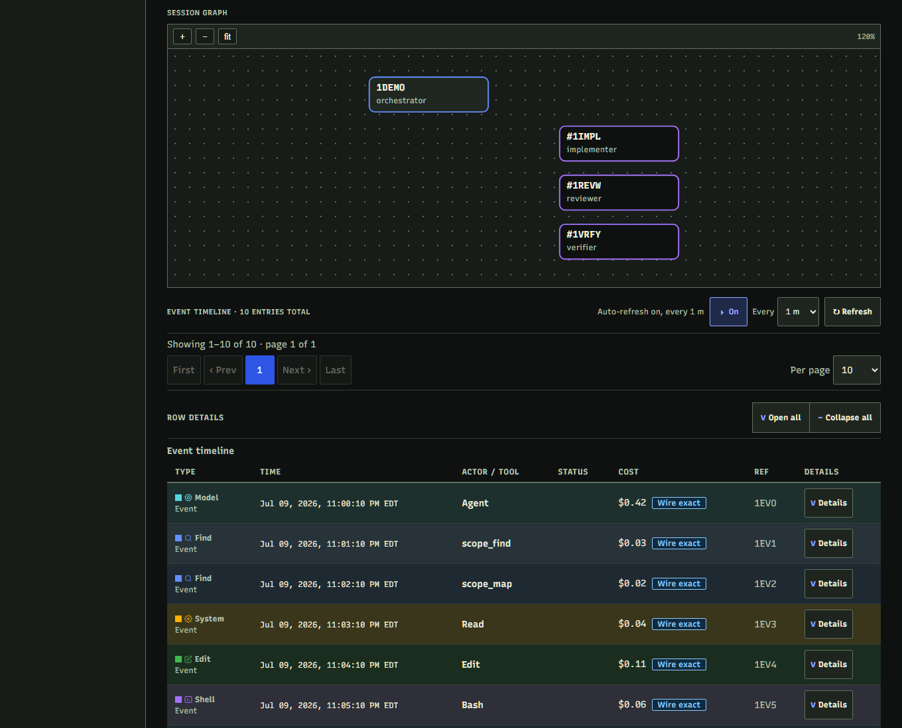
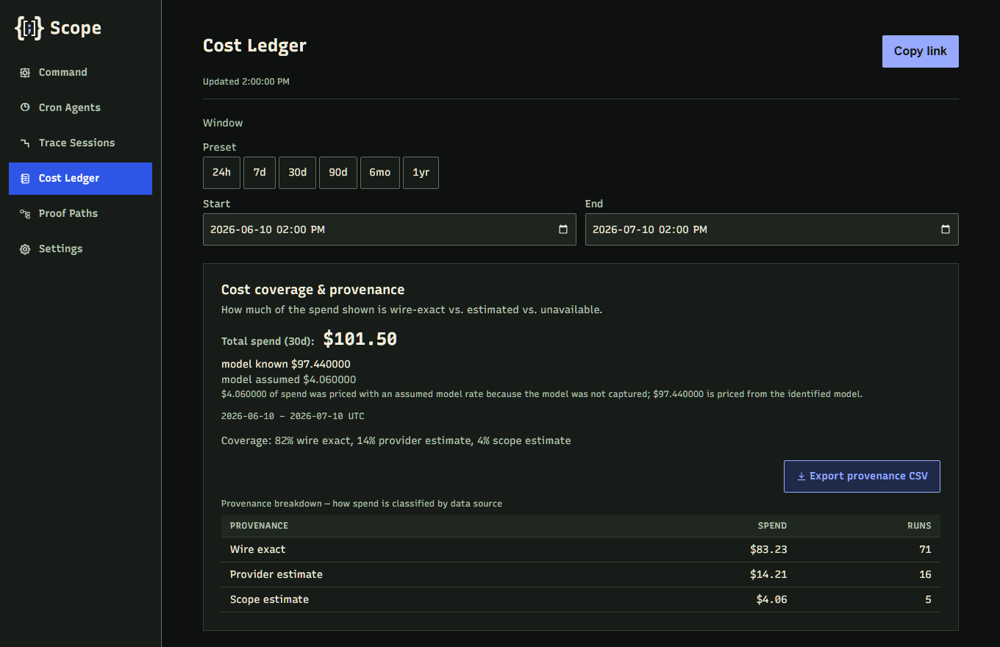

# Scope (excerpt)

> **Status: sunset (2026). This is a read-only excerpt of a private codebase.** It is published as a portfolio sample. The C# doesn't compile here because the code and project files it depends on aren't included, and there are no tests in this repository. All rights reserved; see [LICENSE](LICENSE).

Scope was a local-first code intelligence and observability system for AI coding agents working on .NET codebases. It gave agents compiler-accurate, token-budgeted context about a C# solution, then recorded what those agents did and what they cost.



*Screenshots render the real UI with invented demo data.*

## What's here

This excerpt covers the observability and operations side of Scope.

| Path | Contents |
|---|---|
| `src/Scope.Core/Telemetry` | Trace capture and projection, session graphs, cost rollups, and adapters for Claude Code and Codex hook payloads. |
| `src/Scope.Core/CostEstimation` | Model pricing and cost provenance. |
| `src/Scope.Core/Cron` | Scheduled headless agent runs on Claude Code and Codex, behind harness launcher adapters. |
| `src/Scope.Core/Entitlement` | The license gate: ECDSA P-256 tokens verified offline against a pinned key set, with rotation and a grace window. |
| `Scope.Proxy` | Loopback passthrough proxy that meters Anthropic and OpenAI traffic. |
| `frontend` | The React and TypeScript dashboard. |
| `docs` | Notes on [license key rotation](docs/entitlement-key-rotation.md) and [external interface boundaries](docs/external-interface-boundaries.md), plus design tokens. |

## What isn't here

Code intelligence was the core of the product, and it stays private: indexing, storage, search and ranking, context packing, the graph service, and the benchmarks. So do the tests, test data, and internal planning documents.

Comments may refer to code or task IDs (such as `T-2026-07-02-01` or `ST-08`) that aren't published. "Owner" in a comment means the human directing the agents.

## Running the dashboard

The dashboard is the one part that builds on its own, and it needs a Scope server for live data, which this repository can't provide. These commands typecheck, lint, and build it:

```powershell
cd frontend
npm ci
npm run check
npm run build:app
```

## Cost you can audit

Every dollar figure in the UI carries its provenance: wire exact, provider estimate, or Scope estimate. An unknown cost renders as unknown, never as `$0.00`.



## How it was built

Scope was built with AI coding agents under my direction. An orchestrator agent decomposed work into task specs with paired verification files, implementers worked in isolated git worktrees, separate reviewer agents approved changes statically, and the full test gate had to pass before each merge.

The full private codebase had 5,280 passing automated tests at its last full build. That number can't be reproduced from this excerpt, whose history starts with a snapshot commit and includes only commits that touch published files.
